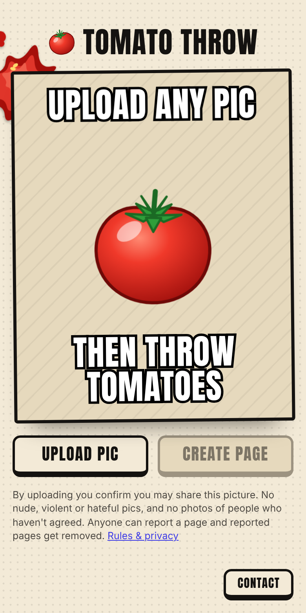
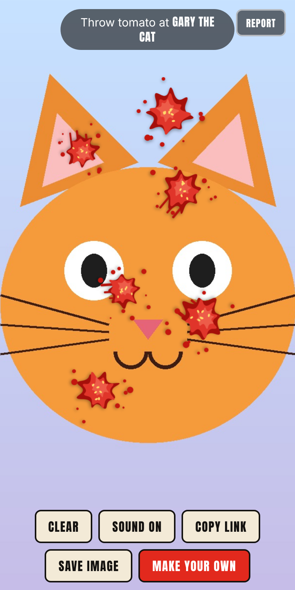

# Tomato Throw

Upload a picture, get a link, and let anyone who opens it throw tomatoes at the picture.

**Live: [tomatothrow.com](https://tomatothrow.com)**


I kept seeing TikTok videos where a tomato flies at the camera, shrinks as it goes, and splats across the screen. This is that, in a browser, aimed at whatever picture you give it. No accounts, no emails. You choose a file, optionally name it, and get a link you can paste into a group chat.

## What it does

- Turns an uploaded PNG, JPG, WEBP or GIF into a full-screen page. Tap or click anywhere to throw a tomato at that spot.
- Animates the throw along a curve, with scale, spin, impact shake and synthesized sound (WebAudio, no audio files).
- Builds a preview image per picture (the picture plus seeded splats), so shared links look good in X, Slack, Discord and iMessage. Titles read "Throw tomato at *name*".
- **Save image** renders the picture with its splats into a JPG; **Share** uses the Web Share API where the browser has one.
- Lets visitors report a picture. Three different reporters delete it automatically, and an admin route lets you delete one by hand.
- Works on phones, tablets and desktops, including landscape.

| Home | Picture page | Link preview |
| --- | --- | --- |
|  |  |  |

## Run it locally

You need Node.js 20.9 or newer (22 is what I develop on).

```bash
git clone https://github.com/p33mTheRealOne/throw-the-tomato.git
cd throw-the-tomato
npm install
npm run dev
```

Open <http://localhost:3000>. No environment variables are needed: without Blob credentials, pictures are written to `./.uploads` and served from there. Delete that folder any time to start fresh.

`npm install` also builds `sharp`, which needs a prebuilt binary for your platform. That works on current macOS, Windows and Linux; on an unusual setup, see the [sharp install docs](https://sharp.pixelplumbing.com/install).

Other scripts:

```bash
npm run typecheck   # tsc --noEmit
npm run build       # production build
npm start           # serve the production build
```

## Deploy to Vercel

1. Import the repo into Vercel.
2. In the project's **Storage** tab, create a **Blob** store and connect it to the project. A private store is the right choice; the app serves pictures through its own route. Vercel adds the credentials as environment variables.
3. Set the variables below, then deploy.

Vercel serverless functions have a read-only disk, so without Blob an upload will fail there. That's why the local-disk fallback only applies off Vercel.

## Environment variables

Copy `.env.example` to `.env.local` for local work. On Vercel, set them in the project settings.

| Name | Required | What it does |
| --- | --- | --- |
| `NEXT_PUBLIC_SITE_URL` | Production | Your public origin, e.g. `https://tomatothrow.com`. Used for canonical URLs, preview images and the sitemap. |
| `BLOB_STORE_ID` or `BLOB_READ_WRITE_TOKEN` | Production | Added when you connect a Vercel Blob store. Either one switches storage from disk to Blob. |
| `BLOB_ACCESS` | No | Set to `public` only if your store is public. Default is `private`. |
| `ADMIN_TOKEN` | Recommended | 16+ random characters. Unlocks the admin routes. Unset means those routes return 404. |
| `REPORT_THRESHOLD` | No | Different reporters needed to auto-delete a picture. Default 3. |
| `REPORT_SALT` | Recommended | Random string mixed into the reporter hash. The default is in this repo, so set your own. |
| `UPLOAD_DIR` | No | Where local pictures go when Blob isn't configured. Default `./.uploads`. |
| `NEXT_PUBLIC_CONTACT_X`, `_GITHUB`, `_LINKEDIN`, `_INSTAGRAM` | No | Links shown in the contact dialog. Empty entries are hidden. |

If you fork this, change the GitHub default in `lib/contacts.ts` or override it with `NEXT_PUBLIC_CONTACT_GITHUB`; it currently points at my profile.

## Moderation

Anyone with the link can see a picture, and anyone can upload one, so moderation isn't optional on a public deployment.

- Visitors press **Report** and pick a reason. Each reporter counts once per picture, using a short one-way hash of their address.
- When `REPORT_THRESHOLD` different reporters flag a picture, it's deleted along with its reports.
- With `ADMIN_TOKEN` set:

```bash
# see reported pictures
curl -H "Authorization: Bearer $ADMIN_TOKEN" https://your-site/api/admin/reports

# delete one now (the id is the 12 characters after /p/ in the URL)
curl -X POST -H "Authorization: Bearer $ADMIN_TOKEN" \
  -H "Content-Type: application/json" \
  -d '{"id":"<id>"}' https://your-site/api/admin/delete
```

- Uploads (10 per 10 minutes) and reports (8 per 10 minutes) are limited per IP, in memory. On serverless each warm instance counts separately, so this stops casual floods and nothing more. Put a Vercel Firewall rate-limit rule on `/api/upload` and `/api/report` as well.

## Project layout

```
app/
  page.tsx                 home page and its metadata
  p/[id]/                  a picture page (metadata, loading skeleton)
  og/                      preview images (home, and per picture)
  api/upload, img, report  upload, serve, report
  api/admin/               token-protected moderation routes
  privacy-terms/           rules and privacy page
  sitemap.xml/, robots.txt/
components/                TomatoStage (throw animation), HomeClient, Splat, ReportButton, ...
lib/
  storage.ts               Blob or local-disk storage, reports, deletion
  splat-shape.ts           seeded splat geometry, shared by page, preview and Save image
  save-image.ts            renders the splatted picture to a canvas
  rate-limit.ts, admin.ts
```

Each picture is one file named `<id>~<base64url(name)>.<ext>`, so a single list call tells the app whether the picture exists and what it's called. There's no database. How the animation, storage and preview rendering work is written up in the docs repository, if you published one; otherwise the code is short enough to read.

## Contributing

Bug reports, fixes and ideas are welcome. Read [CONTRIBUTING.md](CONTRIBUTING.md) first; it's short. To report a security problem, see [SECURITY.md](SECURITY.md) and please don't open a public issue.

## License

[MIT](LICENSE). Third-party pieces keep their own licenses: Next.js, React, sharp, `@vercel/blob`, `react-icons`, and the Anton typeface (SIL Open Font License) loaded through `@fontsource/anton`.
